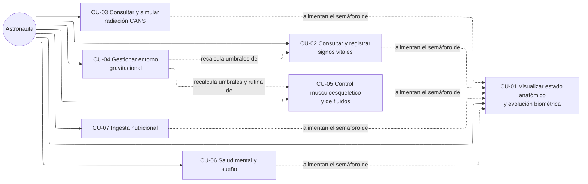

# Casos de uso

Actor único: **astronauta** ([ADR-0004](adr/0004-actor-del-sistema.md)). Todas las evaluaciones usan el entorno gravitacional activo (CU-04).

Los umbrales concretos están en [reglas clínicas](04-reglas-clinicas.md).

---

## CU-01 · Visualizar estado anatómico y evolución biométrica

**Objetivo:** ver de un vistazo qué parte del cuerpo está bien y cuál necesita atención.

**Flujo principal**
1. El astronauta abre el panel general (`/`).
2. El sistema muestra el gemelo digital 3D coloreado por estado (verde nominal, ámbar precaución, rojo crítico) y las cuatro zonas: Cardiopulmonar, Neurológico, Inmune y metabólico, Músculo-esquelético.
3. El astronauta hace clic en una estructura o una zona.
4. El sistema aísla la estructura y muestra su función, sus métricas y la acción recomendada.
5. El astronauta abre "Tendencias 28 días" y ve las gráficas de la zona, con líneas de umbral del entorno actual.

**Criterios de aceptación**
- El color de cada zona es el peor estado de sus estructuras y de sus indicadores.
- Las líneas de umbral de las tendencias cambian al cambiar la gravedad.

**Implementación:** `InteractiveBodyMap`, `OrganInspector`, `VitalTrendsModal`, `GetVitalHistoryUseCase`.

---

## CU-02 · Consultar y registrar signos vitales

**Objetivo:** conocer los signos vitales actuales y registrar una medición propia.

**Flujo principal**
1. El sistema muestra los signos vitales en vivo (frecuencia cardíaca, presión, SpO₂, gasto cardíaco, PIC, temperatura) con su estado.
2. El astronauta pulsa "Registrar medición".
3. El formulario indica, para cada campo, **cómo tomar la medida** a bordo.
4. El astronauta guarda; el sistema valida rangos fisiológicos, evalúa contra los umbrales del entorno y recalcula el estado de los órganos.
5. El sistema confirma y dice qué hacer: todo en rango, repetir en 30 min (precaución) o repetir en 5 min y avisar a los médicos de vuelo (crítico).

**Flujo alternativo**
- 4a. Valor fisiológicamente imposible o diastólica ≥ sistólica: se rechaza con el error en el campo.

**Criterios de aceptación**
- 153/75 mmHg en 0 g se marca **crítico** (umbral crítico 150); en la Tierra, solo precaución (umbral crítico 160).
- La medición manual aparece de inmediato en la tira de signos vitales en vivo.

**Implementación:** `VitalsStrip`, `RecordVitalsDialog`, `useRecordVitalsController`, `RecordVitalSignsUseCase`.

---

## CU-03 · Consultar y simular exposición a radiación CANS

**Objetivo:** controlar la dosis acumulada y reaccionar ante una tormenta solar.

**Flujo principal**
1. El astronauta abre Dosimetría (`/radiation`).
2. El sistema muestra los medidores de flujo de neutrones (CANS) y tasa de dosis, la dosis de carrera contra el límite de 600 mSv y la curva de dosis acumulada.
3. El astronauta pulsa "Simular evento SPE".
4. El sistema suma la dosis a todos los dosímetros y evalúa.
5. Si la tasa o el flujo superan el nivel crítico: **alerta roja de refugio** ("ve al módulo blindado") y, al salir, **chequeo inmunológico** (hemograma y linfocitos).

**Flujo alternativo**
- 5a. La dosis acumulada llega al 80 % del límite: alerta crítica con dormir en la zona blindada, evitar EVA y chequeo inmunológico.

**Criterios de aceptación**
- Tras simular un SPE aparece la alerta de refugio con la indicación de chequeo inmune.
- La zona Inmune pasa a precaución cuando se requiere chequeo inmunológico.

**Implementación:** `CansRadiationWidget`, `useRadiationController`, `LogRadiationExposureUseCase`.

---

## CU-04 · Gestionar el entorno gravitacional

**Objetivo:** que las reglas clínicas correspondan a dónde está el astronauta.

**Flujo principal**
1. El astronauta elige **dónde está** en la barra superior: nave en tránsito o ISS (0 g), base o rover lunar (0.16 g), base o rover marciano (0.38 g), Tierra (1 g).
2. El sistema recalcula los umbrales (presión, PIC, pérdida ósea esperada, fluid shift esperado), **la rutina obligatoria de ejercicio** (en un rover, sin máquina de resistencia, usa bandas elásticas), **el blindaje frente a la radiación** y **a dónde ir si hay una tormenta solar**.
3. Todas las pantallas se actualizan con los nuevos colores y referencias.

**Criterios de aceptación**
- 0 g → rutina de 150 min (ARED 60 + cinta T2 45 + CEVIS 45); Marte → 90 min; Tierra → 60 min.
- Una sistólica de 135 mmHg es nominal en la Tierra (umbral 140) y precaución en 0 g (umbral 130).

**Implementación:** `GravityEnvironmentBar`, `useGravityController`, `ChangeGravityEnvironmentUseCase`, `GravityEnvironment` (value object), `ClinicalRulesService.thresholdsFor`.

---

## CU-05 · Gestionar control musculoesquelético y de fluidos

**Objetivo:** frenar la pérdida ósea y muscular y detectar efectos del fluid shift.

**Flujo principal**
1. El astronauta abre Salud integral (`/wellbeing`).
2. El sistema muestra densidad ósea (y su proyección a 30 días), fluid shift, elongación espinal, masa muscular y el avance de la rutina del día.
3. Al completar un bloque de la rutina, el astronauta pulsa "Hecho" y se suman los minutos.
4. El astronauta reporta síntomas de **visión borrosa** y **mareo** en una escala de 0 a 3, con una prueba sencilla guiada para cada uno.
5. El sistema evalúa y avisa: precaución, o crítico con indicación de detener tareas de riesgo y contactar a los médicos de vuelo.

**Criterios de aceptación**
- Visión "moderado" con fluid shift fuera de rango → **crítico**; la zona Neurológica y los ojos lo reflejan.
- Registrar un bloque de 45 min sube el contador de ejercicio en 45.

**Implementación:** `BoneFluidsCard`, `usePhysicalController`, `LogPhysicalStatusUseCase`.

---

## CU-06 · Gestionar salud mental y sueño

**Objetivo:** detectar a tiempo el deterioro por aislamiento.

**Flujo principal**
1. El astronauta registra un check-in: horas de sueño, estrés (1–10), ánimo (1–10) y notas opcionales.
2. El sistema muestra el historial de 14 días y evalúa el último check-in.
3. El sistema evalúa además la **tendencia**: días seguidos con sueño < 6 h, ánimo ≤ 4 o estrés ≥ 8.
4. Si la racha llega a 3 días → precaución; si llega a 5 → crítico, con una recomendación concreta.

**Criterios de aceptación**
- Tres días seguidos durmiendo menos de 6 h generan la alerta "3 días seguidos durmiendo menos de 6 h…".
- Si hay varios check-ins el mismo día, cuenta el último.

**Implementación:** `MentalWellbeingCard`, `useWellbeingController`, `LogMentalCheckinUseCase`.

---

## CU-07 · Gestionar ingesta nutricional

**Objetivo:** cubrir lo mínimo que el cuerpo necesita en el espacio.

**Flujo principal**
1. El sistema muestra barras de progreso de calorías, agua, calcio, vitamina D y proteínas contra el objetivo diario.
2. El astronauta registra una ingesta con un botón rápido (ración principal, agua, bebida láctea, suplemento Ca + D, barra proteica).
3. El sistema suma, evalúa contra el **ritmo del día** (no contra el total) y avisa de lo que falta o de lo que sobra.

**Criterios de aceptación**
- A media jornada, haber tomado el 20 % del agua genera "Hidratación insuficiente para el ritmo del día".
- Superar 2000 mg de calcio genera una alerta de riesgo de litiasis renal.

**Implementación:** `NutritionGoalsCard`, `useNutritionController`, `ValidateDailyNutritionUseCase`.
