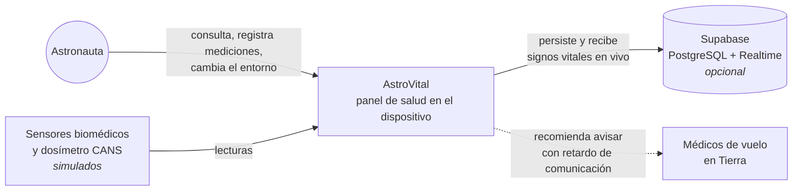
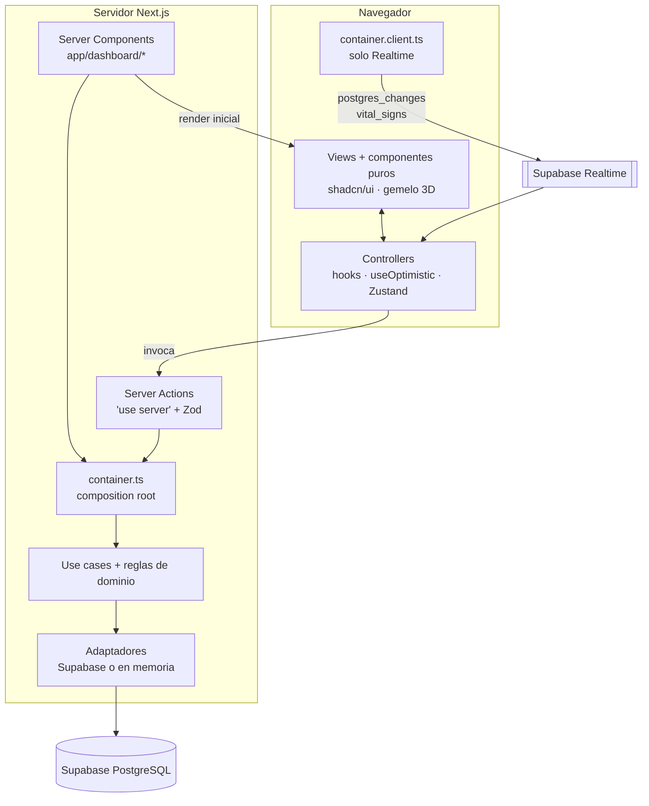
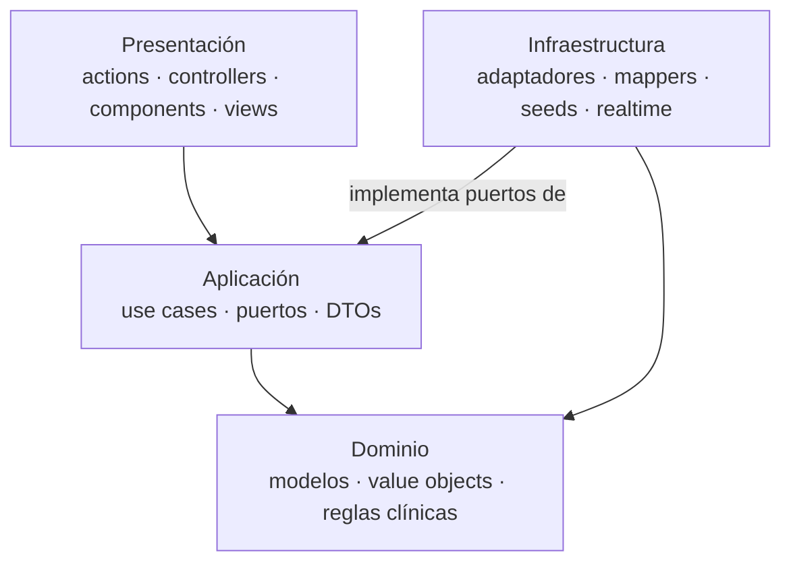
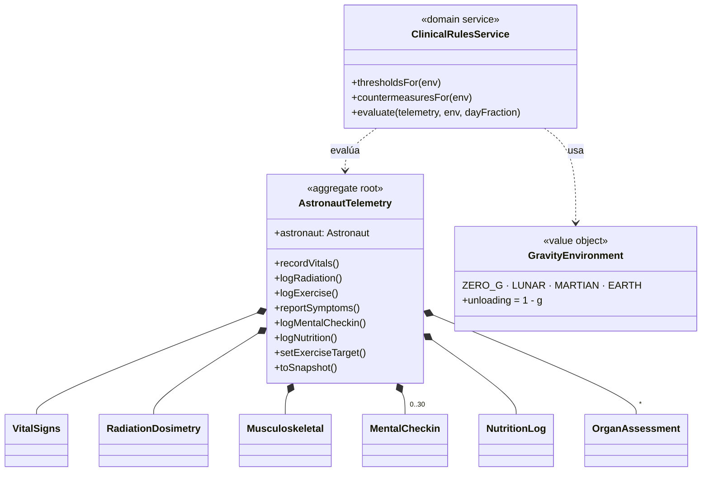
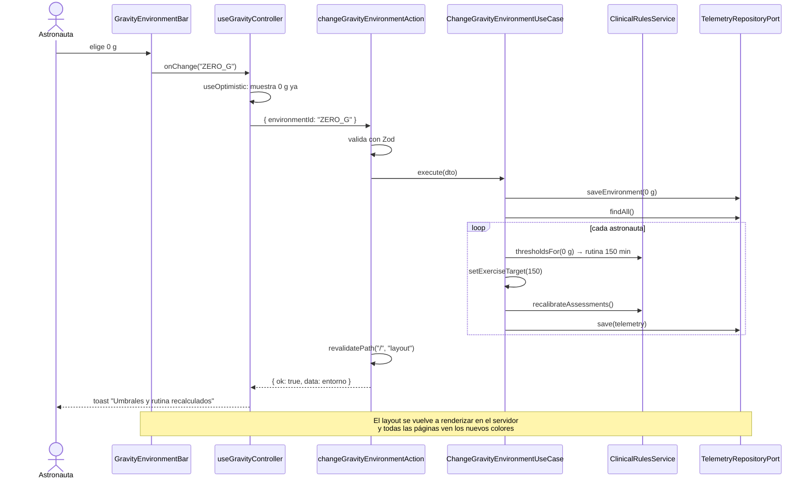
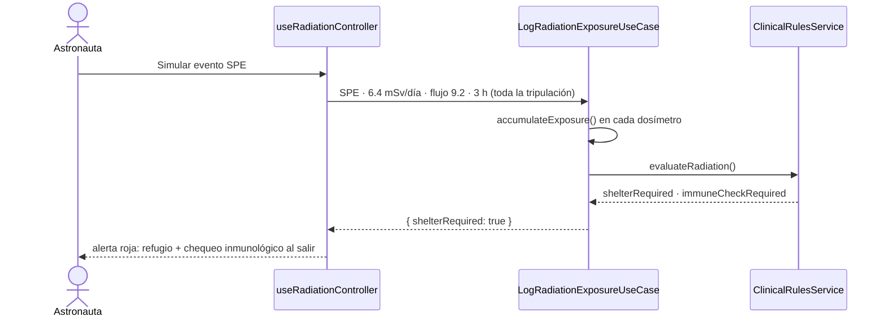

# Arquitectura

AstroVital combina **Clean Architecture**, **vertical slicing por feature** y **DDD táctico** sobre **Next.js 15 (App Router)** y **TypeScript estricto** ([ADR-0001](adr/0001-clean-architecture-vertical-slices-ddd.md)). El dominio clínico es TypeScript puro: no conoce React, Next ni Supabase.

## Stack

| Categoría | Tecnología | Rol |
|---|---|---|
| Framework | Next.js 15 (App Router) + React 19 + TypeScript estricto | Server Components, Server Actions |
| UI | shadcn/ui (Radix + Tailwind CSS v4) en `core/presentation/ui` | Primitivas accesibles |
| 3D | three.js + @react-three/fiber + drei | Gemelo digital (modelo BodyParts3D) |
| Gráficas | Recharts vía `ui/chart.tsx` | Tendencias |
| Estado cliente | Zustand (solo estado de UI) + `useOptimistic` / `useTransition` | Controllers |
| Validación | Zod | DTOs e inputs de Server Actions |
| Backend | Supabase (`@supabase/ssr`): PostgreSQL, RLS, Realtime | Opcional: sin variables de entorno se usan adaptadores en memoria |
| Notificaciones | sonner | Toasts de alerta |

## Contexto (C4 nivel 1)



## Contenedores (C4 nivel 2)



## Capas y regla de dependencia

Las dependencias apuntan siempre hacia el dominio.



| Capa | Puede importar | Nunca importa |
|---|---|---|
| `domain/` | Solo TypeScript estándar | React, Next, Supabase, UI |
| `application/` | `domain/` | Infraestructura, React, Next |
| `infrastructure/` | `application/` (puertos), `domain/` | Presentación |
| `presentation/` | `application/` (DTOs), `domain/` (tipos), `core/presentation` | Adaptadores concretos (se resuelven en el contenedor DI) |

## Bounded contexts (slices)

| Slice | Responsabilidad | Casos de uso |
|---|---|---|
| `health-monitoring` | **Núcleo.** Telemetría biomédica, reglas clínicas, gravedad, radiación, musculoesquelético, mente, nutrición | CU-01 a CU-07 |
| `clinical-diagnostics` | Diagnósticos e hipótesis a partir de archivos clínicos (imagen, audio, PDF, DICOM). **Analizador simulado** | Extra |
| `mission-ops` | Botiquín y lecturas de soporte vital de cabina (ECLSS) | Extra |

El agregado raíz del núcleo es `AstronautTelemetry`: todo el estado biomédico de un astronauta. Se modifica solo a través de sus métodos (`recordVitals`, `logRadiation`, `logExercise`, `reportSymptoms`, `logMentalCheckin`, `logNutrition`, `setExerciseTarget`) y se guarda completo.



## Estructura de directorios

```text
src/
├── app/(dashboard)/                 Rutas: / · /crew · /diagnostics · /medkit · /radiation · /wellbeing · /environment
│   ├── layout.tsx                   Carga el resumen (SSR) y monta MissionDashboardLayout
│   └── */page.tsx                   Server Components: piden datos al contenedor DI
├── core/
│   ├── infrastructure/
│   │   ├── di/container.ts          Composition root del servidor (único lugar con `new`)
│   │   ├── di/container.client.ts   Composition root del navegador (solo Realtime)
│   │   ├── supabase/                Cliente SSR (cookies) y cliente de navegador
│   │   └── clock/                   Reloj del sistema (ClockPort)
│   ├── presentation/
│   │   ├── ui/                      Primitivas shadcn/ui
│   │   ├── layouts/mission-dashboard/
│   │   └── shared/                  StatusBadge, Sparkline, PageHeader, EcgTrace…
│   └── utils/                       cn.ts, action-result.ts (runAction: Zod + mapeo de errores)
└── features/
    ├── health-monitoring/
    │   ├── domain/                  models · value-objects · services/clinical-rules · errors
    │   ├── application/             ports/out · dto (Zod) · use-cases
    │   ├── infrastructure/          persistence (adaptadores, mapper, seeds) · realtime · anatomy
    │   └── presentation/            actions · controllers · components · views
    ├── clinical-diagnostics/        Misma estructura de 4 capas
    └── mission-ops/                 Misma estructura de 4 capas
supabase/
├── migrations/                      0001_init.sql · 0002_cu_gaps.sql
└── seed.sql                         Generado con scripts/generate-supabase-seed.ts
```

**Diferencias con la especificación original:**
- La silueta del cuerpo es un **gemelo 3D** (three.js + BodyParts3D), no un SVG.
- Se agregó una carpeta `presentation/views/` que compone componentes y controllers por página.
- `MetricTrendChart` vive en `features/health-monitoring/presentation/components/trends/`, no en `core/`.

## Flujos clave

### Cambio de entorno gravitacional (CU-04)

Recorre todas las capas: es el flujo de referencia.



### Tormenta solar y refugio (CU-03)



## Reglas de implementación

1. **Dominio puro:** `features/**/domain/**` no importa `react`, `next`, `@supabase/*` ni librerías de UI.
2. **Vista separada de datos:** los componentes (`presentation/components/**`) reciben datos por props y emiten callbacks. No hacen fetching ni llaman a Server Actions. La orquestación (carga, `useOptimistic`, errores, Realtime) vive en `presentation/controllers/**`.
3. **shadcn/ui:** toda primitiva visual se importa de `@/core/presentation/ui/*`.
4. **Supabase dual:** Server Components y Server Actions usan el cliente SSR a través de `container.ts`; los controllers que necesitan Realtime usan `container.client.ts`.
5. **Mappers:** la conversión `snake_case` ↔ `camelCase` ocurre solo en `infrastructure/persistence/mappers/*.mapper.ts`.
6. **Inyección de dependencias:** nunca `new *Adapter()` ni `new *UseCase()` fuera de `core/infrastructure/di/`.
7. **Server Actions como única frontera de escritura:** toda mutación pasa por `runAction(schema, input, fn)`, que valida con Zod y convierte los `DomainError` en mensajes para la UI.

## Cómo añadir una funcionalidad

1. Dominio: modelo o regla nueva en `domain/` (TypeScript puro).
2. Aplicación: DTO con Zod y caso de uso que use los puertos.
3. Infraestructura: columnas nuevas en una migración `supabase/migrations/000N_*.sql`, y actualizar mapper y seed (los dos adaptadores comparten el mapper).
4. Registrar el caso de uso en `core/infrastructure/di/container.ts`.
5. Presentación: Server Action → controller → componente puro.
6. Verificar: `npm run typecheck` y `npm run lint`.
